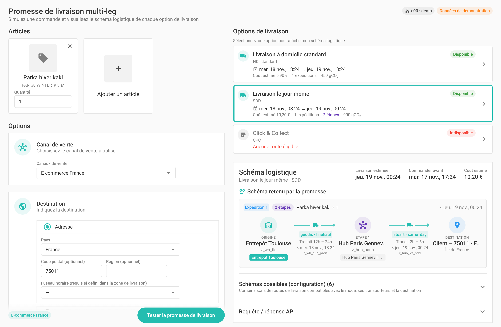
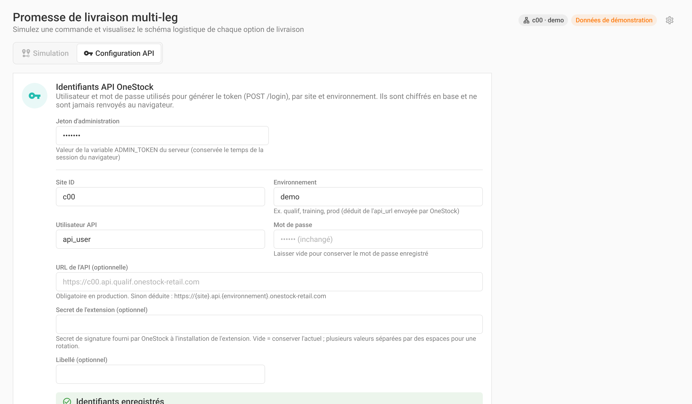

# dpmultileg – Promesse de livraison multi-leg (extension UI OneStock)

Une extension UI OneStock (`bo.page`) qui permet de :

1. **sélectionner des articles** (`GET /items`) et leurs quantités,
2. **choisir un canal de vente et une destination** (adresse, zone ou lieu de stock), avec en option le prix de commande, les modes de livraison et une date de simulation (même écran que le testeur de promesse du back-office),
3. **calculer les options de livraison** : la promesse est **reconstruite par l'extension**, sans appeler `GET /delivery_promises`, à partir de :
   - `GET /delivery_configs` : la configuration du mode dont les zones de livraison contiennent la destination, ses transporteurs, ses opérations et temps d'exécution, ses priorités, son nombre maximal d'expéditions et ses restrictions appliquées ;
   - `GET /delivery_routes` et `GET /zones` : les chaînes de routes possibles (multi-leg), avec leurs temps de transit et leurs coûts ;
   - `GET /stocks` : le stock disponible (on hand) dans chaque lieu de stock d'origine ;
   - `GET /delivery_restrictions` et les contraintes colis des routes, évaluées sur les caractéristiques des articles (catégories, poids, dimensions) ;
4. **voir le schéma logistique** de chaque option : la ou les routes sélectionnées selon les priorités du mode (par exemple la plus rapide parmi celles qui ont le stock), et pour chaque autre schéma la raison pour laquelle il n'est pas retenu (pas de stock, restriction, contrainte colis, critère de priorité).

**Algorithme** (`shared/promise.ts`) : pour chaque mode, l'extension prend la configuration correspondant à la destination, puis les schémas candidats. Elle exclut, par article, les schémas soumis à une restriction ou à une contrainte colis, puis vérifie le stock à l'origine. Les schémas restants sont classés selon les priorités : une seule expédition est privilégiée, puis la commande est éclatée dans la limite autorisée. La date estimée vaut l'heure de la demande (ou la date simulée), plus les opérations du mode, plus le transit. Les calendriers (enlèvement, ouverture, livraison) et les grilles de coûts ne sont pas évalués : c'est une estimation à partir de la configuration.



## Architecture

```
web/        Front Vue 3 + TypeScript (Vite), basé sur le design system OneStock
server/     API Node (Express) : session d'extension, identifiants chiffrés, proxy OneStock
shared/     Logique métier commune : zones, chaînage multi-leg des routes, typage
api/        Point d'entrée serverless Vercel (réutilise l'app Express)
```

### Contexte d'appel et sécurité

Le contrat suivi est celui de [UI Extensibility – How to develop UI Extensions](https://onestock.atlassian.net/wiki/spaces/DOCUMENTAT/pages/1691418644).

1. OneStock charge l'iframe avec `extension_id, user_id, site_id, lang, timezone, locale, parent_url, injection_point_path, host_app`.
2. Le front envoie `extension_ready` à l'origine de `parent_url` et reçoit `onestock_data` (`api_url`, `extension_signature`…). L'origine du message est vérifiée.
3. `POST /api/session` : le back-end retrouve les identifiants du **site** et de l'**environnement** (déduit de `api_url` : `qualif`, `training`, `prod`…) et émet un JWT court. **La signature de l'extension n'est pas vérifiée par défaut.** Avec `VERIFY_SIGNATURE=true`, elle est contrôlée (HMAC-SHA256 de `${t}.${extension_id}##${user_id}`, h0/h1/h2, 6 h maximum) avec le secret d'extension enregistré pour le site et l'environnement.
4. Les appels OneStock passent par le back-end : un token est obtenu via `POST /login` avec l'utilisateur et le mot de passe stockés. Il est mis en cache par site et environnement, puis renouvelé automatiquement en cas de 401. Les identifiants ne quittent jamais le serveur et ne sont envoyés qu'à l'`api_url` enregistrée, ou à défaut à un hôte `*.onestock-retail.(com|dev)`.
5. Le front demande le redimensionnement de l'iframe (`extension_resize`) et utilise `lang`, `locale` et `timezone` pour les traductions (fr/en) et les dates.

Les GET OneStock avec corps sont envoyés en `POST` + `X-HTTP-Method-Override: GET` (méthode supportée par l'API).

### Identifiants en base (par site et environnement)

Table `credentials` / `dpm_credentials` : `site_id`, `environment`, `user_id`, `password` (chiffré AES-256-GCM), `api_url` (optionnelle), `extension_secrets` (secrets de signature, chiffrés), `label`.

**Depuis l'interface (onglet caché « Configuration API »)** : cliquer sur l'engrenage discret en haut à droite, ou sur « Configurer les identifiants » dans une erreur d'identifiants ou de signature. On peut aussi ouvrir l'onglet directement avec `?config=1`. Le mot de passe d'administration (variable `ADMIN_TOKEN`) n'est demandé que si cette variable est définie. Sans elle, l'écran est ouvert à toute personne qui a l'URL et un avertissement l'indique. On saisit ensuite le site, l'environnement (tous deux pré-remplis d'après le contexte OneStock), l'utilisateur API, le mot de passe et, en option, l'URL d'API (et le secret d'extension si `VERIFY_SIGNATURE=true`). « Tester la connexion » appelle `POST /login` sans rien enregistrer. « Enregistrer » chiffre et stocke les identifiants, vide le cache de tokens, puis relance la connexion. Laisser le mot de passe ou le secret vide conserve la valeur déjà enregistrée. Ces valeurs ne sont jamais renvoyées au navigateur.



En ligne de commande :

```bash
npm run creds -- set --site c00 --env qualif --user mon_user_api --password '***' --secret <hash_extension> --label "Qualif"
```

```bash
npm run creds -- list
```

```bash
npm run creds -- delete --site c00 --env qualif
```

Ou via l'API d'administration (protégée par `ADMIN_TOKEN`) :

```bash
curl -X PUT https://<app>/api/admin/credentials/c00/qualif \
  -H "Authorization: Bearer $ADMIN_TOKEN" -H 'Content-Type: application/json' \
  -d '{"user_id":"mon_user_api","password":"***","extension_secrets":["<hash>"],"api_url":"https://c00.api.qualif.onestock-retail.com"}'
```

`api_url` est obligatoire pour la prod (son URL ne suit pas le schéma `https://{site}.api.{env}.onestock-retail.com`). Il faut un secret d'extension par instance OneStock (qualif, training, prod). Sans secret, une session n'est acceptée que si `ALLOW_UNSIGNED=true`.

## Hébergement sur Vercel

1. Importer le dépôt dans Vercel. `vercel.json` configure le build (`npm run build:web` → `web/dist`), la fonction `api/index.ts` (toutes les routes `/api/*`), le fallback SPA et l'en-tête `Content-Security-Policy: frame-ancestors` (back-offices OneStock uniquement).
2. **Base de données** : le système de fichiers Vercel est éphémère, SQLite n'y est donc pas utilisable. Ajouter **Neon Postgres** depuis *Storage / Marketplace* : la variable `DATABASE_URL` est injectée et la table est créée au premier appel.
3. Variables d'environnement **obligatoires** : `CREDENTIALS_KEY` et `JWT_SECRET`, deux chaînes aléatoires de 64 caractères hexadécimaux (`openssl rand -hex 32`). Variables **optionnelles** : `ADMIN_TOKEN` (protège l'onglet de configuration, fortement recommandé) et `VERIFY_SIGNATURE=true` (active la vérification de la signature). Pour une démo sans OneStock : `MOCK_ONESTOCK=true` et `ALLOW_UNSIGNED=true`.
4. Enregistrer les identifiants via l'API admin (voir ci-dessus) avec l'URL Vercel.
5. Déclarer l'extension dans OneStock (`POST /extensions`), par exemple :

```json
{
  "site_id": "c00",
  "token": "{{token}}",
  "extension": {
    "name": "Delivery promise multi-leg",
    "description": "Simulation de promesse et schéma logistique",
    "url": "https://<app>.vercel.app",
    "test_url": "https://<app>-git-main.vercel.app",
    "injection_points": [{ "anchor": "bo.page", "name": "Promesse multi-leg", "path": "/", "rank": 0, "slug": "dp-multileg", "icon": "<base64>" }]
  }
}
```

Puis enregistrer le secret de signature fourni par OneStock dans `extension_secrets`.

## Design system OneStock

Le code importe `@onestock-public/design-system` (`OsButton`, `OsSelect`, `OsCardLayout`, `OsPicto`, `OsBadge`…). Ce paquet est privé (registre GCP, accès sur demande, token valable 1 h) :

```bash
gcloud artifacts print-settings npm --repository os-npm-public --location europe-west4 --project os-tools-abm42i --scope @onestock-public
```

```bash
npx google-artifactregistry-auth --registry https://europe-west4-npm.pkg.dev/os-tools-abm42i/os-npm-public --scope @onestock-public --repo-config ~/.npmrc
```

```bash
npm install @onestock-public/design-system
```

Une fois le paquet installé, Vite l'utilise automatiquement. Sinon, il bascule sur `web/src/ds/`, un repli local qui reproduit la même API (props, événements, slots) d'après la [documentation du design system](https://design-system.onestock-retail.com), avec les vraies couleurs, la typographie Roboto et les icônes OneStock. Le dépôt compile et se déploie donc sans accès au registre. Pour utiliser le paquet officiel sur Vercel, il faut fournir un `.npmrc` authentifié au build.

## Développement

```bash
npm install
```

```bash
MOCK_ONESTOCK=true npm run dev
```

Ouvrir http://localhost:5173. Hors iframe, un mode autonome (développement uniquement) permet de choisir un site et un environnement. En mode mock, le jeu de données simule un retailer français : entrepôt de Toulouse, hubs de Paris et Marseille, magasins, coursier jour même en Île-de-France, ferry vers la Corse, navettes magasins pour le Click & Collect.

```bash
npm test
```

```bash
npm run typecheck
```

```bash
npm run build && npm start
```

## Diagnostic des erreurs

- **À l'écran** : chaque erreur précise l'étape qui a échoué (handshake, session, référentiel, test), le statut HTTP, le code, le message (de l'API OneStock le cas échéant), une piste de résolution et le `request id`. Le bloc *Détails techniques* contient le contexte reçu de OneStock (paramètres d'URL, `onestock_data`, signature masquée), la réponse brute et l'état du serveur (`/api/health`). Le bouton *Copier le diagnostic* copie l'ensemble, qui est aussi écrit dans la console du navigateur (`[dpmultileg]`).
- **Côté serveur** (Vercel > Logs) : une ligne JSON par requête (`msg: http`, `request_id`, statut, durée, site, environnement), et des événements dédiés : `session_request`, `session_missing_credentials`, `session_invalid_signature` (avec la raison), `onestock_login`, `onestock_call` (avec le `Request-Id` OneStock), `onestock_error`, `onestock_unreachable`, `internal_error` et `startup_failed`. Mots de passe, tokens et signatures ne sont jamais journalisés. `LOG_LEVEL=debug` journalise aussi les appels OneStock réussis.
- **`GET /api/health`** : variables manquantes, connexion à la base, liste des couples site/environnement configurés, version Node, région et commit Vercel.
- Si une variable obligatoire manque, l'API répond un JSON `503 server_misconfigured` qui la nomme, au lieu de planter. Si la fonction Vercel ne démarre pas, `api/index.ts` renvoie l'erreur en JSON (`startup_failed`).

## Hypothèses et limites

- Les routes `GET /delivery_configs`, `/delivery_routes` et `/zones` sont internes et leur réponse n'est pas documentée : `shared/normalize.ts` accepte un tableau, un objet indexé par id ou une enveloppe `{ delivery_routes: [...] }`.
- Le schéma retenu s'appuie sur `delivery_options[].delivery_routes` (id, transporteur, articles). Les routes qui portent les mêmes articles forment une expédition. Leur ordre est reconstitué par les zones : la zone d'arrivée d'une étape doit être une zone de stock (définie par des lieux de stock), partagée avec la zone de départ de l'étape suivante. Si l'API ne renvoie pas les routes, seuls les schémas possibles sont affichés.
- Les schémas possibles sont une reconstitution à partir de la configuration (zones, transporteurs du mode, routes). Les restrictions, calendriers et contraintes colis ne sont pas évalués : c'est le rôle du calcul OneStock, dont le résultat reste la référence.
